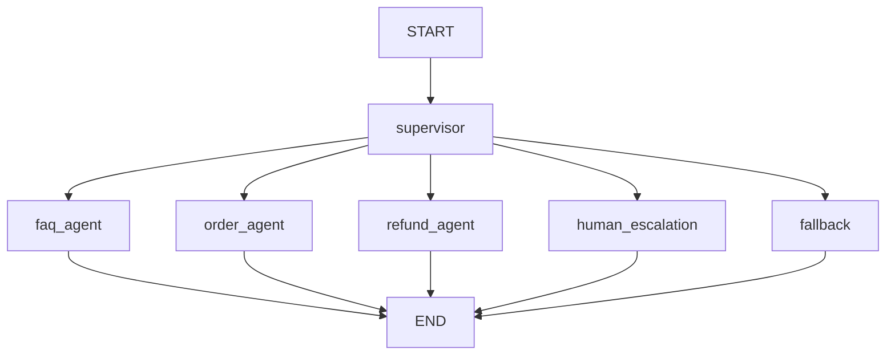

# ShopAssist AI - Multi-Agent Customer Support System

An agentic customer support system built with LangGraph, LangChain, FAISS, SQLite, and Streamlit, powered by local LLMs (Ollama / `qwen2.5-coder`).

## Overview

ShopAssist AI routes and fulfills customer support queries across multiple specialized agents using a supervised multi-agent workflow:



### Specialized Agents

- **Supervisor**: Classifies customer intent using local LLMs and routes requests to the appropriate specialist.
- **FAQ Agent**: Retrieves relevant store policies using RAG (SentenceTransformers + FAISS vector search).
- **Order Agent**: Queries SQLite database for order status, tracking, and customer verification.
- **Refund Agent**: Evaluates deterministic refund eligibility based on return windows and product conditions.
- **Human Escalation & Fallback**: Handles out-of-scope queries and simulated customer representative transfers.

---

## Architecture & Directory Structure

```text
├── agents/               # Individual agent implementations
│   ├── supervisor.py     # Intent classification and workflow routing
│   ├── faq_agent.py      # RAG-based FAQ responder
│   ├── order_agent.py    # Order lookup and tracking
│   └── refund_agent.py   # Refund eligibility checker
├── rag/                  # RAG components and vector retriever
├── data/                 # Sample SQLite database, policies, and test data
├── evaluation/           # Evaluation metrics, confusion matrices, and test cases
├── app.py                # Streamlit web application interface
├── app_support.py        # Streamlit session state and workflow adapter
├── workflow.py           # LangGraph multi-agent graph compilation
├── database.py           # SQLite connection and helpers
├── main.py               # CLI runner for queries
└── requirements.txt      # Python dependencies
```

---

## Quickstart

### 1. Prerequisites & Installation

Clone the repository and install dependencies:

```bash
git clone https://github.com/Jiwak-Hash/Agentic_Project.git
cd Agentic_Project
pip install -r requirements.txt
```

### 2. Start Local Ollama

Ensure Ollama is running with the required model:

```bash
ollama serve
ollama pull qwen2.5-coder:latest
```

### 3. Run the Streamlit Web App

```bash
streamlit run app.py
```

Open [http://127.0.0.1:8501](http://127.0.0.1:8501) in your browser.

### 4. Run via CLI

```bash
python main.py --customer-id 16 "Where is order 1001?"
```

---

## Running Tests

Execute test suites for database, agents, workflow, and web app:

```bash
python test_app.py
python -m unittest -v test_database.py
python test_faq.py
python test_order_agent.py
python test_refund_agent.py --live
python test_workflow.py --live
```

---

## Documentation

- [README_APP.md](README_APP.md): Streamlit application details and configuration.
- [README_WORKFLOW.md](README_WORKFLOW.md): LangGraph workflow and intent routing matrix.
- [README_ORDER.md](README_ORDER.md): Order Agent specification.
- [README_FAQ.md](README_FAQ.md): FAQ Agent and RAG architecture.
- [README_REFUND.md](README_REFUND.md): Refund rules and verification logic.
