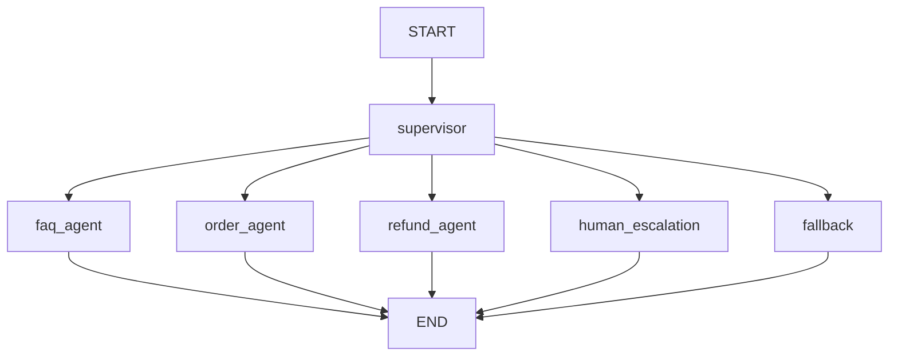

# DemoCart support workflow

The Supervisor uses local `qwen2.5-coder:latest` to classify one customer request.
Python validates the intent and selects a fixed LangGraph destination. Existing
FAQ, Order, and Refund Agents retain their original logic and response validation.



Exactly one destination runs per request. All destination nodes lead directly to
END; there are no loops, tool selection, or follow-up LLM rewrites of answers.

| Intent | Destination | Behavior |
|---|---|---|
| track_order | order_agent | Existing tracking/listing and ownership checks |
| change_order | order_agent | Explain that changes are unavailable |
| cancel_order | order_agent | Explain that cancellation requires customer support |
| delivery_period | faq_agent | General shipping/delivery policies |
| delivery_options | faq_agent | Shipping methods/destinations if documented |
| check_refund_policy | faq_agent | General return/refund policy |
| get_refund | refund_agent | Existing deterministic eligibility assessment |
| track_refund | refund_agent | Explain that refund-status/payment records are absent |
| complaint | human_escalation | Explicitly simulated escalation |
| contact_human_agent | human_escalation | Explicitly simulated escalation |
| unsupported | fallback | Ask for one supported request |

The destination adapters handle unavailable operations without constructing the
specialist or querying records. In particular, refund eligibility is never presented
as the status of an existing refund. The escalation node does not create a ticket
or contact anyone.

## Run

From `/home/jiwak/Agentic_Project`, with local Ollama running:

```bash
python -m pip install -r requirements.txt
python main.py --customer-id 16 "Where is order 1001?"
python main.py --customer-id 6 --evaluation-date 2026-10-10 "Can I get a refund for order 1002?"
python main.py --customer-id 16 "What is your shipping policy?"
python main.py --customer-id 16 "I want to speak to a human agent"
```

The CLI ID simulates a trusted session; it is not authentication. In an application,
obtain the ID from authenticated session data, not a request/message field supplied
by the customer. The caller also supplies any evaluation-date override. Without an
override the Refund Agent uses the current date in Asia/Kolkata.

```python
from workflow import build_workflow

graph = build_workflow()
result = graph.invoke({
    "message": customer_message,
    "customer_id": trusted_session_customer_id,
})
print(result["response"])
```

The TypedDict state includes `message`, `customer_id`, optional `evaluation_date`,
`intent`, `selected_agent`, `response`, `sources`, `agent_result`, `error`, and
`used_fallback`. The input schema accepts only the three input fields. The graph
recomputes routing/output fields for each invocation; Qwen cannot write identity
or arbitrary state updates. Keep technical errors and structured records internal
to the authenticated application. CLI prints the response, destination, and sources.

FAQ initializes lazily and reuses its public-policy retriever. Order/Refund Agents
are created with the current request's trusted ID, so no customer-specific agent is
cached. Supervisor receives only the message, never the trusted customer ID.

## Verification

```bash
python -m unittest -v test_database.py
HF_HUB_OFFLINE=1 python test_faq.py
python test_order_agent.py
python test_refund_agent.py --live
python test_workflow.py
HF_HUB_OFFLINE=1 python test_workflow.py --live
```

Offline Hugging Face mode assumes the existing MiniLM cache is available. Ollama
still needs to run locally. Workflow tests include 18 deterministic cases and eight
optional live cases. Mocked routing tests exercise real LangGraph execution; the
privacy cases also use the actual Order Agent and SQLite helper with mocked model
extraction. Live checks use Qwen, the existing specialists, and the existing orders.

## Limits

This is a single-request workflow without conversation memory or authentication.
Send the order ID again when asking a follow-up. Mixed unrelated requests use the
unsupported fallback. Natural-language classification can be wrong, including under
prompt injection; intent allowlisting prevents arbitrary execution, while database
ownership checks remain enforced independently of routing. Passing the included
tests does not prove resistance to every prompt injection or phrasing.

FAQ answers retain their existing prompt-based grounding limitation. Order and
Refund answers retain their exact-response validation. Refund `eligible` means
conditional eligibility to request a return, not approval or a payment. Missing
policy facts, refund status, and unimplemented actions cannot be supplied by this
workflow. No real cancellation, order changes, refunds, or human tickets occur.

LangGraph API reference:
[StateGraph](https://reference.langchain.com/python/langgraph/graph/state/StateGraph)
and [conditional edges](https://reference.langchain.com/python/langgraph/graph/state/StateGraph/add_conditional_edges).
