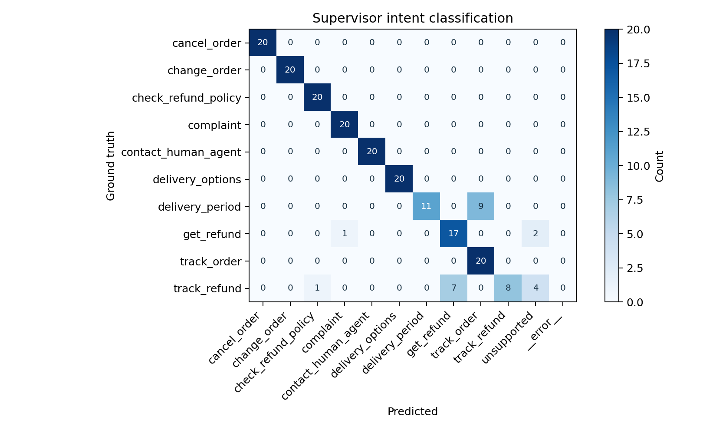
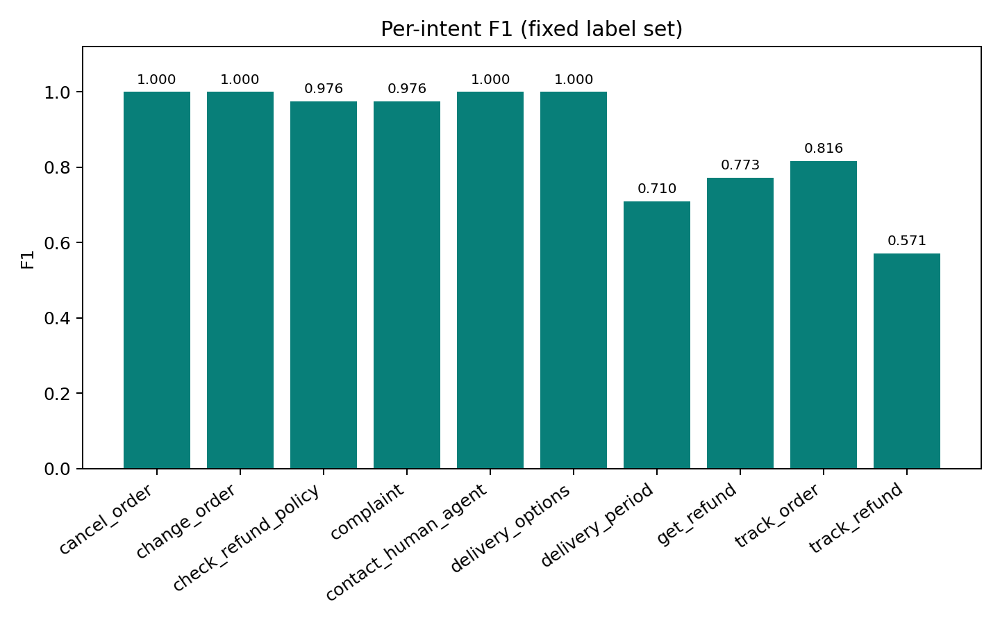
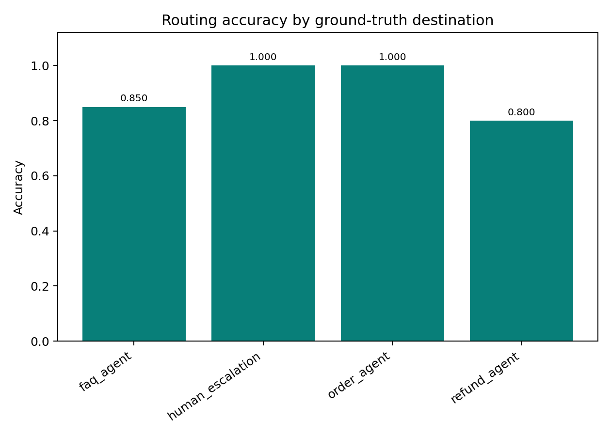

# ShopAssist AI — Final Evaluation

## Project and datasets

ShopAssist combines local Qwen classification, LangGraph routing, policy RAG, SQLite order lookup, deterministic refund assessment, and a Streamlit UI. This evaluates the existing system without training or changing its agents.

Dataset: 9,975 Bitext-derived labeled queries, ten intents; 200 synthetic existing orders; four fictional policy documents. Dataset responses are NOT used as answer truth for DemoCart policies.

## Methodology and reproducibility

Mode: **full**; seed: **42**; target labeled sample: **200**. Equal-size random sampling without replacement within each original intent, then seeded shuffling. Original labels, wording, typos, and placeholders are preserved. Only question text is supplied to Supervisor.classify().

Failed/invalid predictions use __error__ and remain in the denominator. Valid unsupported predictions also remain errors against the ten dataset labels. Macro scores average the fixed ten ground-truth labels; weighted F1 uses their sample support; undefined precision is zero. Confusion matrices retain unsupported/error columns. Routing uses the production intent-to-destination mapping; per-agent accuracy is conditional on the true destination (recall-like), not precision.

All checkpoints are atomic per-case JSON files. Manifest hashes freeze data, policies, application code, and evaluation cases. --resume reuses successes AND failures rather than selectively retrying mistakes. --report-only regenerates artifacts without inference. Models can still be nondeterministic across hardware/runs.

FAQ set: 24 independently authored cases (18 supported, 6 unsupported), including paraphrases and multi-policy prompts. Hit@3 means any predeclared relevant source in the first three; source relevance is filename precision@3, not a semantic ranking judgment. Unsupported questions have no relevant source and are excluded from retrieval denominators.

Rubric for qualitative review: (1) required facts/conditions are included; (2) every asserted policy or order fact is supported by the frozen policy/record; (3) no invented dates, status, approvals, transfers, or real escalation; (4) unsupported questions explicitly abstain without asserting an unavailable policy. A substantive omission, contradiction, or invented rule fails semantic_correct. Refusal correctness uses this same rubric for unsupported questions. Automated regex flags are screening aids, NOT proof of semantic correctness.

Order checks compare full structured records and complete approved factual text against independently serialized database fields; dates must be a subset of recorded dates. Refund fixtures use a temporary database and mocked extraction/generation to isolate policy decisions; expected classes were explicitly specified in advance, not obtained from the tested function. eligible means conditional request eligibility, not approval.

End-to-end: 20 independent single-request scenarios, including all ten intents, fallback, privacy and unsupported operations. Success requires correct destination, automated response/decision checks and qualitative response review. Without complete review coverage the final task-success rate is withheld. No conversational memory or multi-turn capability is claimed.

## Intent classification

Evaluated **200/200** queries; invalid/failed: **0**; valid unsupported predictions: **6**.

| Metric | Value |
|---|---:|
| accuracy | 88.00% |
| macro_precision | 93.03% |
| macro_recall | 88.00% |
| macro_f1 | 88.21% |
| weighted_f1 | 88.21% |





## Routing and confusion analysis

Destination accuracy: **91.50%**. This is separate from intent accuracy: confusing two intents routed to the same specialist can still select the correct destination.

| Ground-truth destination | Support | Correct destination rate |
|---|---:|---:|
| faq_agent | 60 | 85.00% |
| human_escalation | 40 | 100.00% |
| order_agent | 60 | 100.00% |
| refund_agent | 40 | 80.00% |

Most common intent confusions:
- delivery_period → track_order: 9
- track_refund → get_refund: 7
- track_refund → unsupported: 4
- get_refund → unsupported: 2
- get_refund → complaint: 1
- track_refund → check_refund_policy: 1



## Agent-level results

```json
{}
```

### Review provenance

No qualitative reviews have been supplied. Semantic correctness is unmeasured; automated flags must not be described as semantic accuracy.

## End-to-end results

```json
{}
```

The strict unavailable-response check requires the exact generic account-unavailable message and no returned records. A safe fallback can fail this handling check without disclosing information. Privacy-preservation review separately checks the answer and structured result for disclosure; it does not waive routing or task failures.

## Latency

Durations use time.perf_counter around actual invocations. One warm-up per service per process is excluded and separately recorded under warmups/. FAQ initialization is also recorded separately. Five repeated representative calls per service in full mode are descriptive, not a load benchmark. End-to-end timings include routing plus the selected node; no-op/escalation routes are cheaper. Errors are retained in latency statistics. Percentile p95 uses NumPy's linear interpolation. No parallel calls were launched by this evaluator.

```json
{}
```

## Error analysis

See intent_errors.csv for every intent error, including original queries. These are observations against dataset labels, not relabeling decisions. No production prompts or rules were tuned on the evaluation sample.

## Limitations

- Balanced 200-query sample is not a full 9,975-row evaluation. The dataset is synthetic/template-heavy and can contain ambiguous labels, placeholders, and near-duplicates; rows are sampled without replacement but template families are not held out.
- Existing prompts and earlier smoke tests predate this evaluation; this is not a pristine blinded research benchmark. No fine-tuning occurs here.
- Only four policy documents exist; retrieving three gives a generous Hit@3 baseline. Filename relevance is not complete semantic evidence. Qualitative review by the coding assistant has reviewer bias and needs independent human confirmation.
- Refund deterministic accuracy excludes natural-language extraction errors. Real refund execution is absent. Live refund latency and workflow scenarios exercise the local model separately.
- Safety cases are small and do not prove universal resistance to prompt injection. Authentication is simulated. No real refunds/cancellations or human tickets are created.
- Latencies reflect this machine, model/cache state and local load; five repetitions cannot characterize production performance or concurrent users.

## Conclusion

Measured counts and results above describe this frozen evaluation only. Inspect error records and review provenance before using the scores as project claims. Unmeasured sections and incomplete review coverage remain explicit rather than being treated as passing.

Metric reference: [scikit-learn precision/recall/F-score](https://scikit-learn.org/stable/modules/generated/sklearn.metrics.precision_recall_fscore_support.html).

## Saved artifacts and environment

Per-intent precision/recall/F1/support: [classification_report.csv](classification_report.csv). Raw predictions: [intent_predictions.csv](intent_predictions.csv). Cases and responses: faq_results.json, order_results.json, refund_results.json, end_to_end_results.json. Qualitative review: [reviews.json](reviews.json). All per-case observations, including failures, are under checkpoints/.

Local model: `qwen2.5-coder:latest`; digest: `dae161e27b0e90dd1856c8bb3209201fd6736d8eb66298e75ed87571486f4364`. Python: 3.13.11; platform: Linux-7.0.0-43-generic-x86_64-with-glibc2.43; logical CPUs: 20. Exact library versions and protected-file hashes are in [manifest.json](manifest.json). This records the environment but does not establish GPU utilization or isolate other machine load.

The preservation check is saved in [preservation.json](preservation.json). Reproduction and review instructions: [README.md](README.md).
